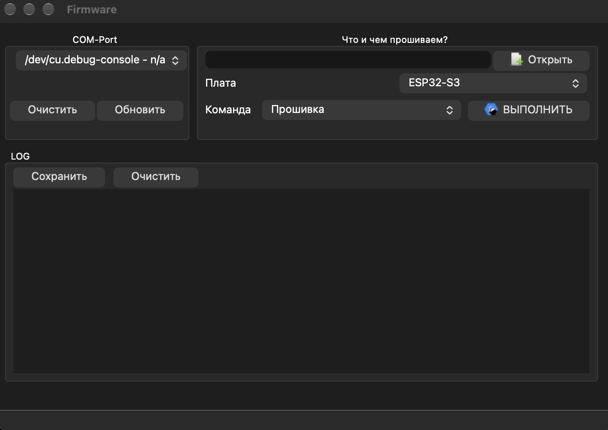
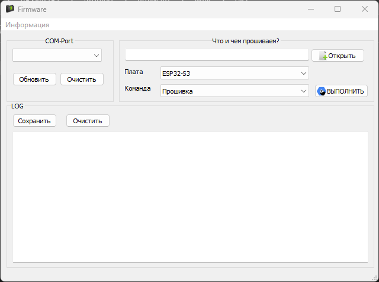

# Firmware Flasher

Программа для прошивки ESP32 / ESP32-S3 / ESP32-C3 / ESP32-S2
через **esptool** без Arduino IDE.

## Фото интерфейса

### macOS

### Windows

## Поддерживаемые платы

| Плата | Статус |
|---|---|
| ESP32-S3 | ✅ Проверено |
| ESP32 | ⚠️ Не тестировалось |
| ESP32-C3 | ⚠️ Не тестировалось |
| ESP32-S2 | ⚠️ Не тестировалось |

## Возможности

- Прошивка из папки `BIN` (как это делает Arduino IDE).
- Прошивка одним `*.merged.bin` по адресу `0x0`.
- Чтение flash в файл `flash_dump.bin`.
- Стирание flash (`erase-flash`).
- Просмотр информации о чипе (`flash-id`).
- Лог всех операций с возможностью сохранения в файл.
- Работа без установленной Arduino IDE (нужен только `esptool` и файлы прошивки).

## Требования

- Python 3.9+ (рекомендуется 3.11–3.13).
- PyQt5
- pyserial
- PyInstaller (только для сборки `.exe` / `.app`)
- Pillow (только для конвертации иконки `.ico` → `.icns` на macOS)

Все Python-зависимости перечислены в `requirements.txt`.

## Установка зависимостей

### Windows

    python -m venv .venv
    .venv\Scripts\activate
    pip install -r requirements.txt

### macOS / Linux

    python3 -m venv .venv
    source .venv/bin/activate
    pip install -r requirements.txt

# Запуск из исходников

    python main.py

